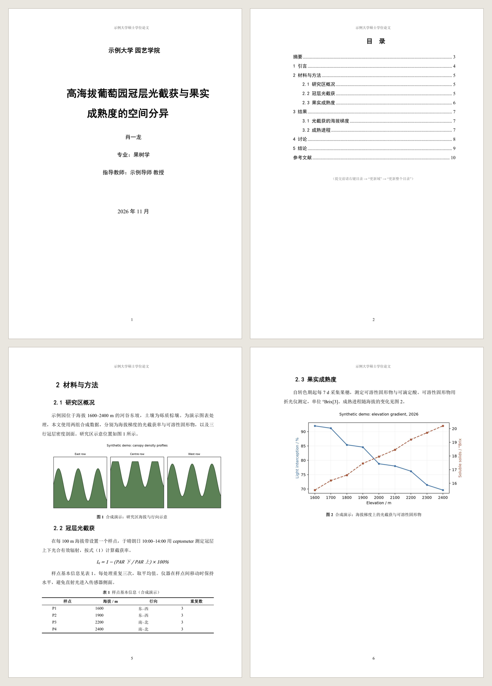

# thesis-forge

把 Markdown 学位论文构建为通用中文高校格式的 .docx，并顺手做一次格式体检。

[](https://github.com/YilongXiao/thesis-forge/actions/workflows/ci.yml)
[](LICENSE)
[](pyproject.toml)



**通用基线，不替代学校模板。** 学校研究生院给出的 `.doc`/`.dotx` 或《格式规范》永远优先；本项目提供的是可复现、可审查、可修改的起点。

## 为什么做这个

内容写在 Markdown 里很轻，交付却必须是 Word。手工把每篇稿子调成 A4、页边距、页眉页码、目录域、三线表和图题，既慢又容易漏。thesis-forge 把这些版式约束写进代码和 YAML 模板，让作者只关心论证，同时用 `check` 在提交前暴露标题编号、题注、引用和中英文标点的问题。

它不追求“一键盲投”：生成的稿子仍要按本校要求逐项核对。

## 安装

需要 Python 3.9+。

Windows PowerShell：

```powershell
py -m venv .venv
.\.venv\Scripts\Activate.ps1
pip install -e .
thesis-forge --help
```

macOS / Linux：

```bash
python3 -m venv .venv
. .venv/bin/activate
pip install -e .
thesis-forge --help
```

## 快速开始

```bash
thesis-forge init -o thesis.md
thesis-forge build thesis.md -o thesis.docx
thesis-forge check thesis.md
```

`build` 会打印图、表数量与警告；图片缺失时仍生成占位框并以退出码 0 结束。`check` 有错误时退出码为 1，仅警告为 0。

使用自定义模板：

```bash
thesis-forge template -o my-university.yaml
thesis-forge build thesis.md -o thesis.docx --template my-university.yaml
```

封面日期可注入，便于复现：

```bash
thesis-forge build thesis.md -o thesis.docx --date 2026-11-17
```

## 输入格式

Markdown 文件必须以 YAML front matter 开头：

```yaml
---
title: "论文题目"
author: "作者姓名"
institution: "××大学"
major: "××专业"
advisor: "指导教师"
date: "2026-11-17"
header_text: "××大学学位论文"
---

# 1 引言

正文段落。标题使用 `#`/`##`/`###`，并自行写“1 引言 / 1.1 小节”式编号。
```

- 图片：``，图题自动编号并放在图片下方；按可用页宽等比缩放。
- 表格：上一行写 `表: 表题`，紧跟标准管道表格；题注自动编号并放在表格上方，输出为三线表。
- 参考文献：`# 参考文献` 之后的 `[1] ...` 段落自动套用悬挂缩进。
- 公式：单独一段 `$$ ... $$` 居中输出（纯文本公式，不解析 LaTeX）。
- 支持的块：标题、段落、有序/无序列表、引用、围栏代码、表格、图片。内联支持粗体、斜体、行内代码。

输出为单个 .docx：A4、上下 2.54 cm / 左 3.0 cm / 右 2.5 cm、页眉、页脚 PAGE 域、`TOC \o "1-3" \h \z \u` 目录域、Heading 1–3 大纲级别与黑体字号、Normal 宋体/Times New Roman 12 pt、1.5 倍行距、首行缩进 2 字符、两端对齐、三线表、图表题注、文档属性。

目录页码需要 Word 更新：打开文档后在目录上右键 →“更新域”→“更新整个目录”。构建时只写域，避免伪造页码。

## 方法与局限

格式依据 GB/T 7713.1—2006、GB/T 7714—2015 的通用要求与常见高校模板整理，详细假设、单位和出处见 [docs/methods.md](docs/methods.md)。

已知局限：

- 封面只有一种通用布局，院系徽标、分类号、学号等字段需自行补充。
- 公式不解析 LaTeX，只按原样居中；复杂公式请在 Word 中重排。
- 目录、页码、交叉引用依赖 Word 更新域，LibreOffice 的域行为可能不同。
- 表格只支持管道表格，合并单元格需在 Word 中处理。
- 页眉从封面开始，部分学校要求封面无页眉页码。
- `check` 基于规则，不理解语义；中英文标点规则对代码与公式可能误报。

## 数据来源

`examples/sample_thesis.md` 与 `examples/figures/` 均为**合成演示数据**，由脚本生成，不代表真实观测。`examples/seed_errors.md` 是故意写坏的种子稿，用于验证检查器。程序本身不联网。

## 测试

```bash
pip install -e ".[dev]"
ruff check .
pytest -q
```

测试构建真实 .docx 并解压检查 `w:pgSz`、`w:pgMar`、TOC/PAGE 域、样式 `w:eastAsia`、`w:outlineLvl`、首行缩进、行距、三线表边框、题注顺序、文档属性与缺图路径；另覆盖检查器的全部规则和 CLI 退出码。

## 引用

```bibtex
@software{xiao2026thesisforge,
  author  = {Xiao, Yilong},
  title   = {thesis-forge: Markdown to Chinese thesis .docx with a format linter},
  year    = {2026},
  version = {0.1.0},
  license = {MIT},
  url     = {https://github.com/YilongXiao/thesis-forge}
}
```

## English summary

thesis-forge turns Markdown thesis drafts into a `.docx` laid out to a generic Chinese university baseline: A4 with asymmetric margins, centered header, PAGE field, a real TOC field, headed outline levels, first-line indents, three-line tables, and numbered figure/table captions. A companion `check` command reports heading numbering, caption, citation, and punctuation problems, with JSON output and meaningful exit codes. The layout is configurable through YAML. This is a reproducible baseline, not a substitute for an official school template: always proof the result against your institution's rules. Figure and table data in the examples are synthetic.

## License

MIT © 2026 Yilong Xiao. See [LICENSE](LICENSE).
