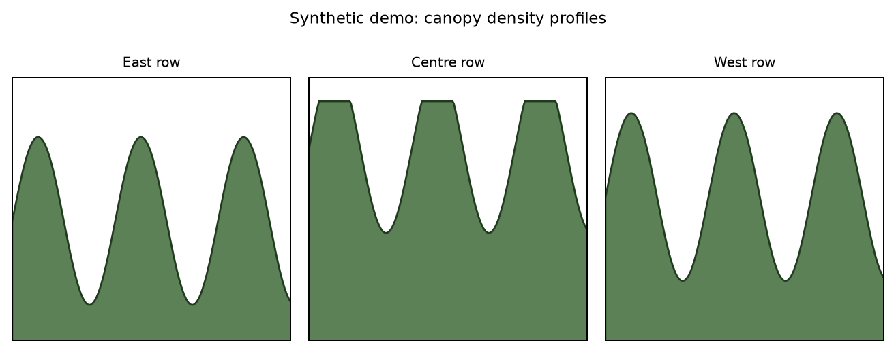
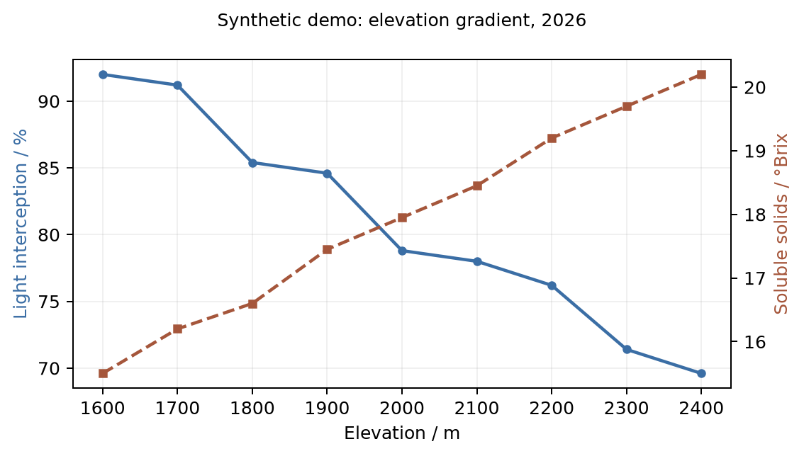

# 摘要

高海拔葡萄园的冠层结构与成熟进程存在显著空间差异。本文以合成演示数据为例，说明如何用 Markdown 撰写论文并使用 thesis-forge 构建符合通用格式的 Word 稿。示例数据均为合成值，不代表真实观测。

**关键词：** 高海拔葡萄园；冠层；光截获；成熟度；排版

# 1 引言

山地葡萄园的光照条件沿海拔与坡向快速变化，冠层管理因此需要更细的空间尺度。已有研究多关注整园平均，忽略了行向与坡位造成的差异[1]。

学位论文最终必须以 Word 交付，而写作过程更适合纯文本。手工调格式既慢又容易出错，因此需要一个可复现的构建器，把版式约束固定在代码与模板里[2]。

本文的目标有三点：一是给出可直接运行的排版基线；二是用自动检查暴露常见的结构与引用错误；三是明确基线与校方模板之间的边界。

# 2 材料与方法

## 2.1 研究区概况

示例园位于海拔 1600–2400 m 的河谷东坡，土壤为砾质棕壤。为演示图表处理，本文使用两组合成数据，分别为海拔梯度的光截获率与可溶性固形物，以及三行冠层密度剖面。研究区示意位置如图 1 所示。

## 2.2 冠层光截获

在每 100 m 海拔带设置一个样点，于晴朗日 10:00–14:00 用 ceptometer 测定冠层上下光合有效辐射，按式（1）计算截获率。

$$
Lᵢ = 1 − (PAR下 / PAR上) × 100%
$$

样点基本信息见表 1。每处理重复三次，取平均值。仪器在样点间移动时保持水平，避免直射光进入传感器侧面。

表: 样点基本信息（合成演示）

| 样点 | 海拔 / m | 行向 | 重复数 |
| --- | --- | --- | --- |
| P1 | 1600 | 东–西 | 3 |
| P2 | 1900 | 东–西 | 3 |
| P3 | 2200 | 南–北 | 3 |
| P4 | 2400 | 南–北 | 3 |

## 2.3 果实成熟度

自转色期起每 7 d 采集果穗，测定可溶性固形物与可滴定酸。可溶性固形物用折光仪测定，单位 °Brix[3]。成熟进程随海拔的变化见图 2。

# 3 结果

## 3.1 光截获的海拔梯度

光截获率随海拔升高而下降，在 1600–1900 m 维持较高水平，2400 m 处降至约 70%。行向与海拔的交互在下午更为明显。

## 3.2 成熟进程

可溶性固形物随海拔升高略有上升，但积温不足使采收窗口缩短约 9 d。三行之间的冠层密度差异小于海拔差异，说明地形是主导因子。

# 4 讨论

冠层密度剖面的差异（图 2）与光截获结果方向一致。高海拔样点的叶面积较小，单叶受光更充分，但整体截获量下降，这与文献报道的补偿效应相符[4]。

本文仅为方法演示，样本量小，且数据为合成值，不能直接用于生产决策。实际论文应报告完整的方差分析与置信区间。

# 5 结论

（1）thesis-forge 可以把 Markdown 稳定转换为具有 A4 页面、页眉页码、目录域、标题大纲与三线表的 .docx。

（2）格式检查能发现标题编号、图表题注与文献引用中的结构问题，减少返工。

（3）构建结果是通用基线，提交前仍需按本校模板逐项核对。

# 参考文献

[1] 李某某. 山地葡萄园光环境空间异质性研究[J]. 园艺学报, 2023, 50(4): 701-712.

[2] 王某某, 赵某. 学位论文排版流程的可复现化[J]. 中国科技期刊研究, 2024, 35(2): 210-218.

[3] 张某. 葡萄果实成熟度无损检测方法综述[J]. 果树学报, 2022, 39(9): 1688-1699.

[4] 陈某某. 高海拔葡萄园冠层管理与品质形成[M]. 北京: 示例出版社, 2021: 88-96.
