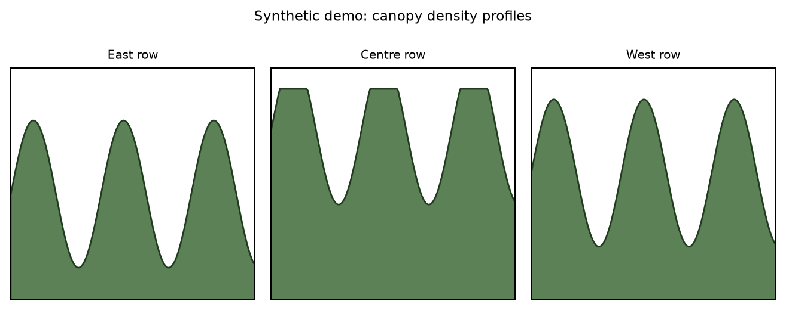

# 引言

本文件故意写入各类格式错误，用于演示 `thesis-forge check`。如图 3 所示，正文引用了一张并不存在的图。中文后面误用了英文逗号,读者应当能发现这一问题。另见文献[9]，该编号超出了文献表范围。

### 直接三级标题

## 1.1 二级标题

## 

正文继续。下面这张图存在重复题注。

图 1 第一张图

图 1 重复的图题

图 4 跳号图题

表 2 从二开始的表题

| 样地 | 海拔 |
| --- | --- |
| P1 | 1600 |

表 2 重复的表题

| 样地 | 海拔 |
| --- | --- |
| P2 | 1900 |

| 列一 | 列二 |
| --- | --- |
|  |  |

下面是一段超过八百字的段落，用来触发长段落提示。高海拔葡萄园的光照条件沿海拔与坡向快速变化，冠层管理因此需要更细的空间尺度。已有研究多关注整园平均，忽略了行向与坡位造成的差异。学位论文最终必须以 Word 交付，而写作过程更适合纯文本。手工调格式既慢又容易出错，因此需要一个可复现的构建器，把版式约束固定在代码与模板里。本文的目标有三点：一是给出可直接运行的排版基线；二是用自动检查暴露常见的结构与引用错误；三是明确基线与校方模板之间的边界。示例园位于海拔一千六百至两千四百米的河谷东坡，土壤为砾质棕壤。为演示图表处理，本文使用两组合成数据，分别为海拔梯度的光截获率与可溶性固形物，以及三行冠层密度剖面。在每百米海拔带设置一个样点，于晴朗日上午十点至下午两点测定冠层上下光合有效辐射并计算截获率。每处理重复三次并取平均值，仪器在样点间移动时保持水平，避免直射光进入传感器侧面。自转色期起每七天采集果穗，测定可溶性固形物与可滴定酸，可溶性固形物用折光仪测定。光截获率随海拔升高而下降，在一千六百至一千九百米维持较高水平，两千四百米处降至约百分之七十。行向与海拔的交互在下午更为明显。可溶性固形物随海拔升高略有上升，但积温不足使采收窗口缩短约九天。三行之间的冠层密度差异小于海拔差异，说明地形是主导因子。冠层密度剖面的差异与光截获结果方向一致。高海拔样点的叶面积较小，单叶受光更充分，但整体截获量下降，这与文献报道的补偿效应相符。本文仅为方法演示，样本量小，且数据为合成值，不能直接用于生产决策。实际论文应报告完整的方差分析与置信区间。以上文字反复展开以凑足长度，便于测试长段落规则是否在正确的行号上触发。若论文字数更多，通常会拆成多个自然段，每段围绕一个中心意思展开，并在段末给出过渡。排版器不自动分段，因此作者需要自己控制节奏。段落过长会让审稿人疲劳，也会让 Word 的版面出现大片灰色文字。经验上每段控制在三百到五百字较为合适，超过八百字就应当考虑拆分，或在段中插入小标题、图表与示例。检查器只能给出提示，真正的段落划分仍要服从论证结构。

# 参考文献

[1] 李某某. 山地葡萄园光环境空间异质性研究[J]. 园艺学报, 2023, 50(4): 701-712.

[1] 王某某. 重复编号的文献[J]. 园艺学报, 2024, 51(1): 1-2.

[2] 赵某. 另一条文献[J]. 果树学报, 2022, 39(9): 1-8.

[3] 陈某某. 只有三条文献但正文引用了第九条[9].
